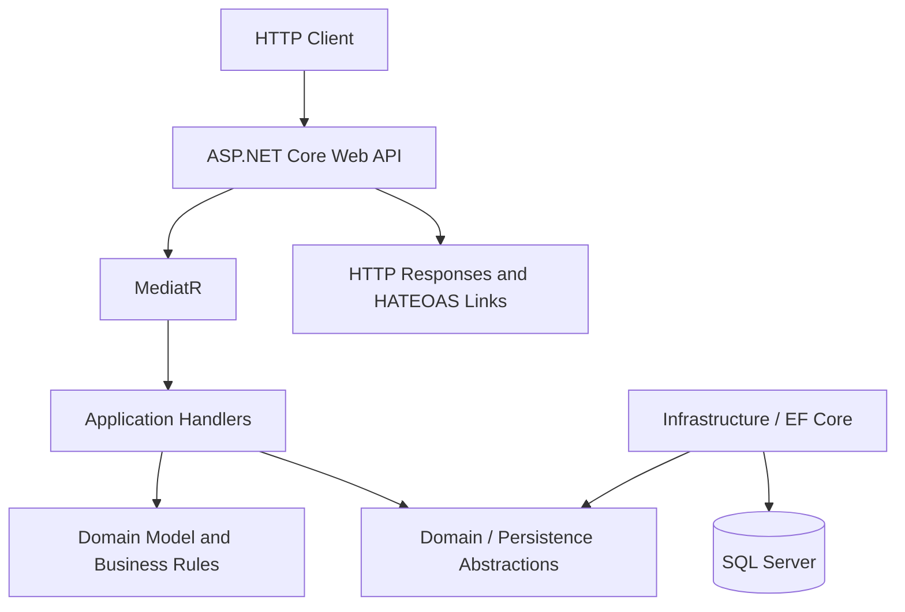

# NewsAgency

A .NET 10 ASP.NET Core Web API for managing news content, authors, and hierarchical categories. The project is built around Clean Architecture principles, domain-focused business rules, CQRS with MediatR, and automated testing.

The project is developed with a TDD-oriented workflow. Its main goal is to practice building a maintainable backend application in which business rules, use cases, persistence, and HTTP concerns have clearly separated responsibilities.

## Project Overview

NewsAgency provides backend capabilities for a small news publishing platform. Its main areas are **Articles**, **Categories**, and **Authors**.

### Main Features

- **Article management:** create and edit articles, retrieve articles by ID or title, and manage article lifecycle operations such as publishing, rejecting, archiving, and moving an article back to draft.
- **Category management:** create and update categories, organize them through parent-child relationships, retrieve a category's parent or children, and remove or restore categories according to domain rules.
- **Author management:** create and retrieve authors, search by ID, first name, last name, email, or phone number, and update author information.
- **CQRS-based use cases:** application operations are separated into commands and queries and dispatched through MediatR.
- **Validation and error handling:** application validation is supported by FluentValidation, while API-level exception handling is centralized through ASP.NET Core's exception-handling pipeline and Problem Details.
- **HATEOAS responses:** API resources expose links to related resources and available operations. For articles and categories, action links are included conditionally according to the action capabilities returned for the resource, rather than exposing every operation unconditionally.

## Architecture

The solution is organized into **13 projects: 7 application/source projects and 6 test projects**.

```text
NewsAgency
│
├── src
│   ├── 00-Utilities
│   │   └── NewsAgency.Utilities
│   │
│   ├── 01-Domain
│   │   └── NewsAgency.Domain
│   │
│   ├── 02-Application
│   │   ├── NewsAgency.Application
│   │   └── NewsAgency.Application.Contracts
│   │
│   ├── 03-Infrastructure
│   │   ├── NewsAgency.Infra.Configuration
│   │   └── NewsAgency.Infra.Data.EFCore
│   │
│   └── 04-EndPoints
│       └── NewsAgency.EndPoints.WebApi
│
└── tests
    ├── 01-Domain
    │   └── NewsAgency.Domain.Tests.Unit
    │
    ├── 02-Application
    │   ├── NewsAgency.Application.Contracts.Tests.Unit
    │   └── NewsAgency.Application.Tests.Unit
    │
    ├── 03-Infrastructure
    │   └── NewsAgency.Infra.Data.EFCore.Tests.Integration
    │
    └── 04-EndPoints
        ├── NewsAgency.EndPoints.WebApi.Tests.Integration
        └── NewsAgency.EndPoints.WebApi.Tests.Unit
```

### Layer Responsibilities

| Layer / Project | Responsibility |
| --- | --- |
| **Domain** | Contains the core business model and domain rules, independently of HTTP and persistence concerns. |
| **Application** | Implements application use cases through CQRS commands and queries, handlers, and validation. |
| **Application.Contracts** | Holds application contracts shared between the application and its callers, including request/response models. |
| **Infrastructure.Data.EFCore** | Implements SQL Server persistence using Entity Framework Core. |
| **Infrastructure.Configuration** | Composes and registers application and infrastructure services for the API. |
| **EndPoints.WebApi** | Exposes HTTP endpoints, maps application results to HTTP responses, provides HATEOAS links, and handles API exceptions. |
| **Utilities** | Contains shared utility code used by the solution. |

### Request Flow



## REST API

The API exposes resource-oriented endpoints under the following routes:

- `/api/Articles`
- `/api/Categories`
- `/api/Authors`

A few examples of the supported operations are listed below.

| Resource | Example endpoint | Purpose |
| --- | --- | --- |
| Articles | `GET /api/Articles` | Retrieve the article collection. |
| Articles | `GET /api/Articles/{id}` | Retrieve an article by ID. |
| Articles | `GET /api/Articles/by-title?title={title}` | Find an article by title. |
| Articles | `POST /api/Articles` | Create an article. |
| Articles | `PUT /api/Articles/{id}` | Edit an article. |
| Articles | `POST /api/Articles/{id}/publish` | Publish an article. |
| Articles | `POST /api/Articles/{id}/reject` | Reject an article. |
| Articles | `POST /api/Articles/{id}/archive` | Archive an article. |
| Articles | `POST /api/Articles/{id}/move-to-draft` | Move an article back to draft. |
| Categories | `GET /api/Categories/{id}/parent` | Retrieve a category's parent. |
| Categories | `GET /api/Categories/{id}/children` | Retrieve a category's children. |
| Categories | `PUT /api/Categories/{id}/parent` | Change a category's parent. |
| Categories | `DELETE /api/Categories/{id}` | Remove a category when domain rules allow it. |
| Categories | `POST /api/Categories/{id}/restore` | Restore a removed category when domain rules allow it. |
| Authors | `GET /api/Authors/by-email?email={email}` | Find an author by email. |
| Authors | `GET /api/Authors/by-phone-number?phoneNumber={phoneNumber}` | Find an author by phone number. |

Swagger is registered by the API and exposed in the Development environment for interactive API exploration.

## HATEOAS

The API uses resource-specific link builders for Articles, Categories, and Authors.

For example, article detail responses can include links such as `self`, `collection`, `edit`, `publish`, `reject`, `archive`, and `moveToDraft`. The action links for editing and article lifecycle operations are added according to the corresponding action flags on the article response model.

Category responses similarly expose links for operations such as changing the title or parent, retrieving the parent, removing, and restoring a category. The `remove` and `restore` links depend on the category's available actions.

This makes the response describe not only the resource, but also the operations currently available according to its domain state. These links represent domain-level action availability; they are not a substitute for user authentication or authorization.

## Technology Stack

- **Platform:** C#, .NET 10, ASP.NET Core Web API
- **Application architecture:** Clean Architecture principles, Domain-Driven Design (DDD), CQRS, MediatR
- **Validation:** FluentValidation
- **Data access:** Entity Framework Core, SQL Server
- **API documentation:** Swagger / Swashbuckle
- **Unit and integration testing:** xUnit, FluentAssertions, NSubstitute
- **API integration testing:** `WebApplicationFactory`, RESTFulSense, Respawn
- **Code coverage collection:** Coverlet

## Testing

Testing is a core part of this project. The test suite is divided into separate projects so that domain behavior, application use cases, persistence, and HTTP endpoints can be tested at the appropriate level.

| Test project | Test scope |
| --- | --- |
| `NewsAgency.Domain.Tests.Unit` | Domain rules and behavior. |
| `NewsAgency.Application.Contracts.Tests.Unit` | Application contract behavior. |
| `NewsAgency.Application.Tests.Unit` | Application handlers and use-case behavior. |
| `NewsAgency.Infra.Data.EFCore.Tests.Integration` | EF Core and SQL Server persistence integration. |
| `NewsAgency.EndPoints.WebApi.Tests.Unit` | Isolated Web API endpoint behavior. |
| `NewsAgency.EndPoints.WebApi.Tests.Integration` | HTTP/API integration through an in-process test host. |

**Current test status:** 672 unit and integration tests have passed in the latest local test run.

Run the complete test suite from the repository root:

```bash
dotnet test NewsAgency.slnx
```

To collect code coverage with Coverlet:

```bash
dotnet test NewsAgency.slnx --collect:"XPlat Code Coverage"
```

> The database-backed integration tests require a SQL Server test database and the connection settings expected by the integration-test setup. Use a dedicated test database, never a production database.

## Getting Started

### Prerequisites

- .NET 10 SDK
- SQL Server (local instance or an accessible SQL Server instance)
- Git

### 1. Clone the repository

```bash
git clone https://github.com/mahdinematix/NewsAgency.git
cd NewsAgency
```

### 2. Restore and build

```bash
dotnet restore NewsAgency.slnx
dotnet build NewsAgency.slnx
```

### 3. Configure the database connection

The API reads the connection string named `NewsAgencyDb` in `Program.cs`:

```json
{
  "ConnectionStrings": {
    "NewsAgencyDb": "Server=localhost;Database=NewsAgencyDb;Trusted_Connection=True;TrustServerCertificate=True;"
  }
}
```

Place local settings in `appsettings.Development.json` or configure the value through .NET User Secrets or the `ConnectionStrings__NewsAgencyDb` environment variable. For SQL Server authentication, use the appropriate `User Id` and `Password` options in the connection string. Do not commit real credentials or production connection strings to source control.

Make sure the target database is available and its schema is up to date with the EF Core model before starting the API.

### 4. Run the API

```bash
dotnet run --project src/04-EndPoints/NewsAgency.EndPoints.WebApi/NewsAgency.EndPoints.WebApi.csproj
```

When running in the Development environment, open the Swagger UI at the local URL printed by ASP.NET Core followed by `/swagger`.

## Planned Work

The project is being extended with additional capabilities. The next areas of work include:

- Acceptance tests for end-to-end business scenarios.
- User management.
- JWT-based authentication and authorization.

These items are planned extensions and are not described as currently implemented features.

## Project Status

NewsAgency is a personal backend development project focused on practical application of domain modeling, application-layer separation, REST API design, and automated testing. It is intended as an evolving codebase for learning, experimentation, and demonstrating backend engineering practices.
